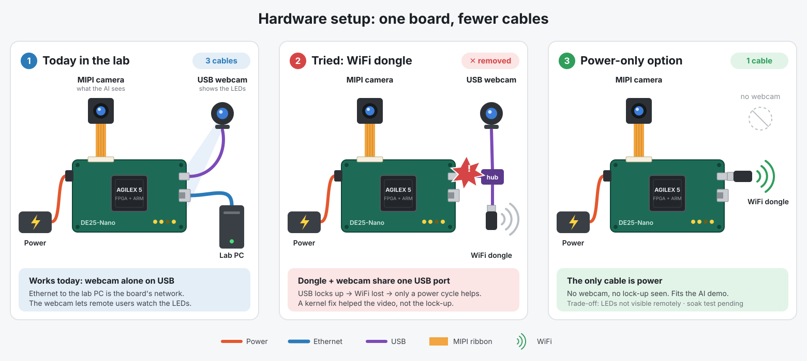
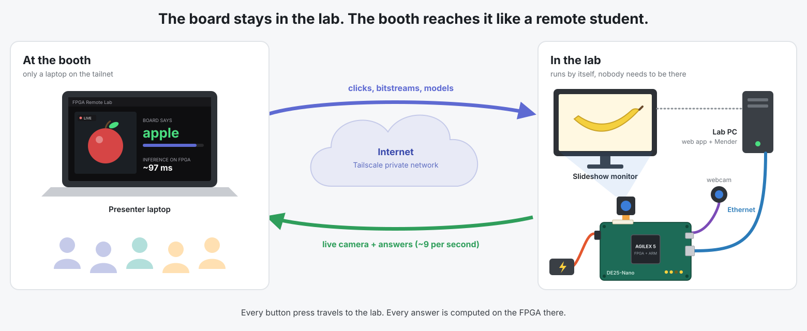
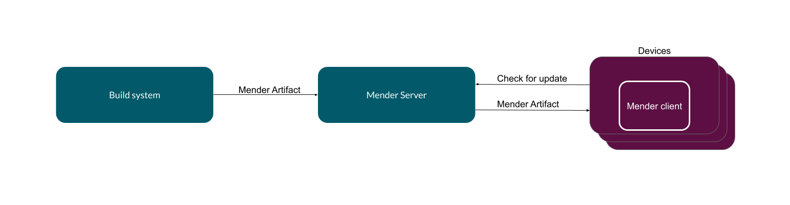
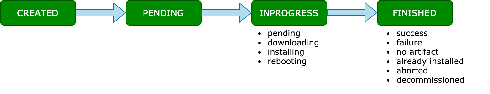
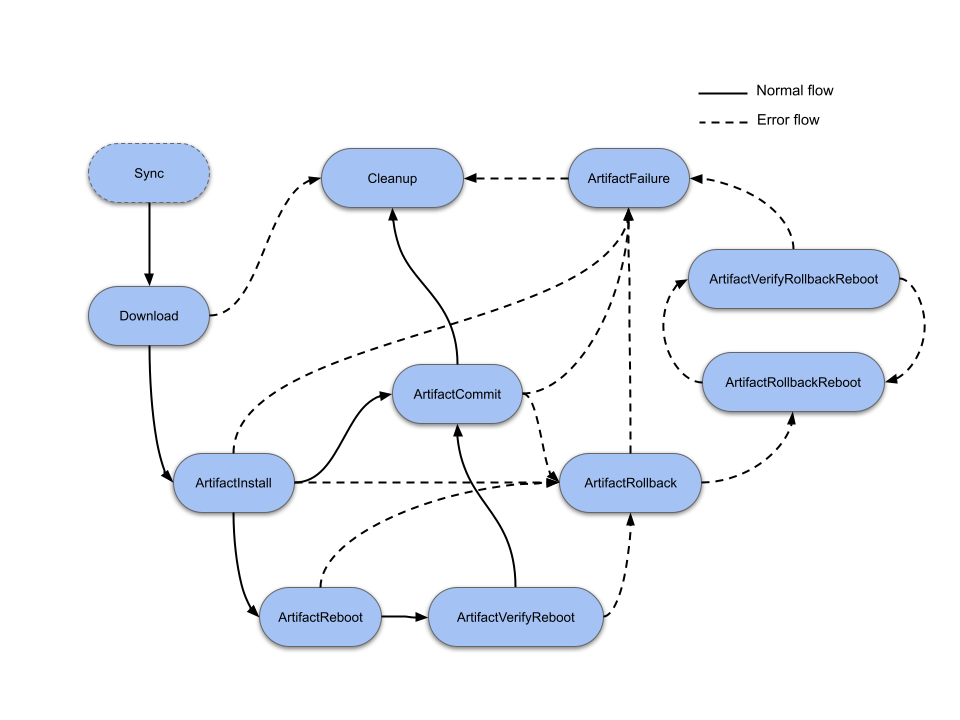
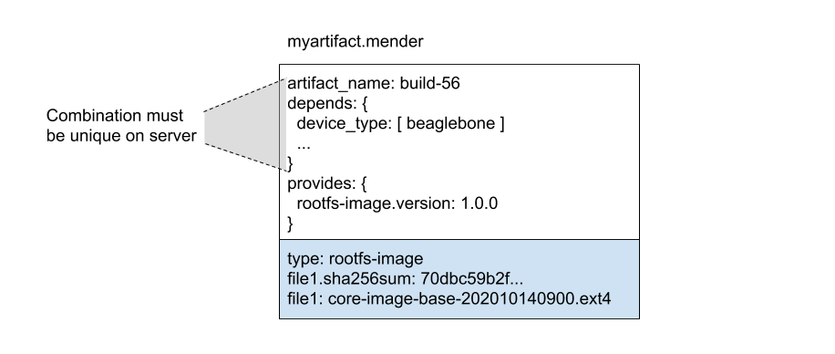
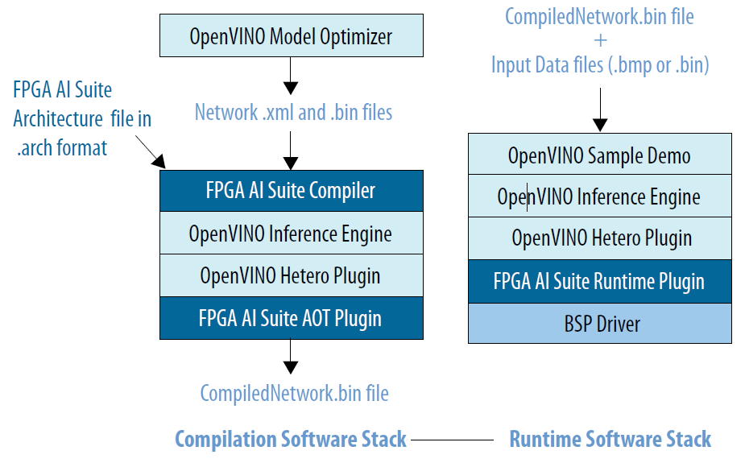
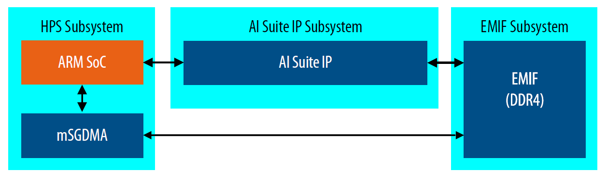
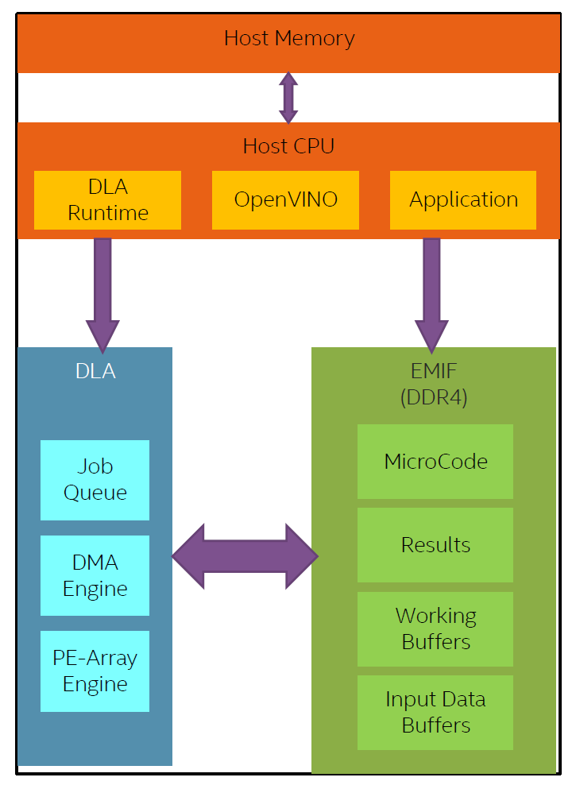

# Demo diagrams: hardware setup, remote booth, reference figures

Status 2026-09-28. For the booth, the report and the poster. The hardware stays in the lab. The booth
has only a laptop that reaches the lab over the network. `[TODO]` = not measured or not tested yet.

## 1. Hardware setup: today, what we tried, power-only option

Physical cables at the board today: **power, Ethernet, USB webcam** (the IMX519 ribbon is on the
board). Sources: `docs/USB_WEBCAM_DWC2_FIFO.md` (board on Ethernet, webcam alone on USB),
`demo/RUNBOOK.md` "If it breaks" (`eno1`, `board-share`, 10.42.0.x), `docs/CAMERA_MIGRATION_PLAN.md`
(IMX519, 2-lane CSI-2). The power input is a DC jack (Terasic DE25-Nano Getting Started Guide §3.4).
Voltage: `[TODO: read it off the adapter]`. `[ASSUMPTION]` The slideshow monitor is driven by the lab PC.

### 1b. What we tried first: WiFi dongle, and why it was removed

- **Cause.** The dongle and the webcam share one dwc2 root port and its FIFO. The webcam's
  isochronous traffic overruns the FIFO, and with both devices attached an SMMU translation fault
  wedges the whole USB bus. The network goes with it (`docs/USB_WEBCAM_DWC2_FIFO.md`: "the dongle sharing
  dwc2 was the co-factor for both the overruns and the wedge").
- **What removing it costs.** A second cable (Ethernet to the lab PC), and the lab PC becomes the board's only uplink.

### 1c. Alternative: an application without the USB webcam needs only a power cable

- **Why it should work.** The USB wedge needs the webcam doing DMA on dwc2. Boots with the dongle and **no
  webcam** ran clean for 1099 s and 1651 s (`docs/CAMERA_MIGRATION_PLAN.md`, final matrix). The
  board ran with the dongle attached through every phase before 2026-09-28. The Edge-AI demo needs only
  the MIPI camera. The USB webcam exists only so a remote viewer can see the board's LEDs.
- **What you lose.** BOARD CAM. A remote user can no longer *see* an LED design run, so this
  setup suits applications whose result comes back as data (for example classification results)
  rather than as LEDs.
- **Known dongle quirks.** A warm reboot can leave the dongle dead. Power-cycle instead
  (`USB_WEBCAM_DWC2_FIFO.md` step list). The live view used to run over a Tailscale relay at ~1.6 MB/s
  (`CAMERA_MIGRATION_PLAN.md`), which is enough for the ~10.7 KB × 28.5 fps ≈ 0.3 MB/s live view.
- `[TODO: soak dongle-only, no webcam, current kernel + camera bitstream, ≥ 15 min with live view and 2 model switches]`.
  Until then, treat this as a design option, not a tested setup.

## 2. Booth ↔ lab (the demo runs remotely)

What changes when the hardware is not at the booth:

| Item | Consequence | Action |
|---|---|---|
| Web UI address | `localhost:8000` works only on the lab PC | Open `http://mender.example.ts.net:8000` (backend listens on `0.0.0.0`, `lab-backend.service`). Mender UI: `https://mender.example.ts.net`. The laptop must be logged in to the tailnet. `[TODO: test from the booth network]` |
| Bandwidth | Live view ≈ 0.3 MB/s + BOARD CAM MJPEG | `[TODO: measure the fps shown at the booth; a Tailscale relay may be used instead of a direct link]` |
| LEDs | Visible only through BOARD CAM | The USB webcam is now essential, not cosmetic. Check its framing before leaving the lab. |
| Slideshow | Must run in the lab, in front of the IMX519 | Lab PC is an X11 session: `ssh fyp-student@mender-host 'DISPLAY=:0 eog --slide-show ~/edge-ai-demo/demo-images/fruit' &` from the booth `[TODO: test; build the flat-flag set]` |
| Power-cycle recovery | Nobody at the board | Serial console via the lab PC (`/dev/ttyUSB0`). A board that needs a power cycle ends the live part: switch to recorded clips. `[TODO: remote power switch or a lab contact]` |
| Lab PC | Single point of failure (backend, Mender, board uplink) | Never sleep. Do not update or reboot it on demo day (stress test ID 8). |

## 3. Reference figures (for curious visitors)

Unmodified third-party figures in `docs/figures/`. Credits are in `docs/figures/SOURCES.md`.

### 3.1 Mender: how an OTA update travels

*Our mapping:* "Build system" = `lab-backend` (`mender-artifact write` for a user `.rbf`) or
`artifacts/build-model.sh` (catalog / uploaded models). "Mender Server" runs in Docker on the lab PC.
"Mender client" runs on the DE25-Nano HPS and checks every 5 s (`board/mender.conf`).

*Our mapping:* these are the states `mender_client.poll_until_finished()` reads. The web UI turns
the device's sub-state into words: *pending* → "waiting for the board to check in and pick up the
update", *downloading* → "board downloading the update", *installing* → "board installing the
update". Only *success* counts as done; any failure → "the board rejected the bitstream and rolled back".

*Our mapping:* both our modules (`board/fpga-reconfig`, `board/coredla-model`) answer
`NeedsArtifactReboot: No` and `SupportsRollback: Yes`. They implement **ArtifactInstall** (copy the
`.rbf` + overlay, reprogram the fabric through `coredla-fpga-up.sh`; the model module also waits for
dla-server `ready`) and **ArtifactRollback** (put the previous set back and reprogram). The reboot
branch of the diagram is never taken. The FPGA is reprogrammed while Linux keeps running.

*Our mapping:* payload of `fpga-reconfig` = `output_design.core.rbf` + `my_overlay.dtb`. Payload of
`coredla-model` = those two + `graph.bin` + `categories.txt` + `*.arch` + `name`.

### 3.2 FPGA AI Suite: from a trained network to answers on the fabric

*Our mapping (left, compile, on the lab PC):* PyTorch → `training/export.py` or the notebook →
OpenVINO IR (`model.xml` + `model.bin`) → `training/compile.sh` runs `dla_compiler` with
`AGX5_Small_k16c16_sb20480.arch` → `graph.bin` (their "CompiledNetwork.bin"). *Right, runtime, on
the board:* `dla-server` → OpenVINO `HETERO:FPGA,CPU` → FPGA AI Suite runtime plugin → mSGDMA/UIO
drivers. Softmax runs on the CPU. All other layers run on the DLA.

*Our mapping:* same structure. The ARM HPS feeds the DLA through mSGDMA, and DLA and DMA share
DDR (`/dev/msgdma_coredla*`, `board/coredla-fpga-up.sh`). Our design adds a camera path next to it:
IMX519 → MIPI receiver → camera mSGDMA → a frame ring in DDR at `0xB4000000`
(`docs/CAMERA_MIGRATION_PLAN.md`).

*Our mapping:* "Application" = `dla-server`, which takes the newest camera frame, crops the centre
square and resizes it to 224×224, then submits the job. The DLA reads its microcode (the compiled `graph.bin`) and
input from DDR and writes the results back. ~97 ms per frame, ~9 per second live
(`docs/DEMO_OPTIMIZATION_PLAN.md` §4).
